# Single-run experiment: results report

_Generated 2026-10-07T01:27:41 by scripts/analyze.py. All numbers come from `results/analysis/tables/*.csv`; this report adds no interpretation._

## Run

- Run started: 2026-10-06T18:14:30Z · prompt template sha256 `c4d2caddb6033ba9…` · gold data sha256 `6b5df09a459cd563…`
- Items: 360 primary stems analysed (+8 `_batch_` versions, A9 only). Excluded before the run: stem_254 (two different events share the ID E18, so the event list is ambiguous)
- Models and request parameters (one call per model and item):

| model | OpenRouter key | parameters | notes |
|---|---|---|---|
| gemini | google/gemini-3.5-flash-lite | {'max_tokens': 65536, 'temperature': 0.0, 'reasoning': {'effort': 'medium'}, 'seed': 20261006} |  |
| qwen | qwen/qwen3.7-flash | {'max_tokens': 65536, 'temperature': 0.0, 'reasoning': {'effort': 'medium'}, 'seed': 20261006} |  |
| gpt-luna | openai/gpt-6-luna | {'max_tokens': 65536, 'reasoning': {'effort': 'medium'}, 'seed': 20261006} | temperature not supported by this model; provider default used |
| mistral | mistralai/mistral-nemo | {'max_tokens': 16384, 'temperature': 0.0, 'seed': 20261006} | no reasoning parameter (model does not support it) |
| deepseek | deepseek/deepseek-v4.1-flash | {'max_tokens': 65536, 'temperature': 0.0, 'reasoning': {'effort': 'medium'}, 'seed': 20261006} |  |

## Method notes

- **Unit of scoring:** upper triangle (i < j in event-list order); the model's cell (i, j) is its answer. Missing or unparseable cells count as wrong (false negative for the gold label, never a false positive).
- **Macro-F1** is the unweighted mean of per-relation F1 over the 13 Allen relations present in the gold set. **Cohen's κ** treats 'missing' as its own predicted category. 7-way = direction ignored; 4-way = before / after / equal / overlap-or-contact family (m, o, s, d, f and inverses).
- **Temporal awareness** (UzZaman & Allen 2011): the gold matrices are complete, so the gold closure equals the gold; precision therefore reduces to accuracy on answered cells and recall to accuracy on all cells.
- **Uncertainty:** 95% CIs from a cluster bootstrap over stems (1000 resamples, seed 20261006). Model comparisons: paired stem-level bootstrap, Holm-corrected; bootstrap p-values have resolution 1/(B+1), so the smallest possible value is 0.0010. These CIs reflect sampling of stems only, not run-to-run variance (each model was run once).
- **Regressions (A6, A14):** logistic GEE clustered by stem with an independence working correlation (i.e. logistic regression with cluster-robust standard errors), used instead of a random-intercept model.
- **Repair (A3a):** nearest consistent network = fewest changed labels, solved with OR-Tools CP-SAT (endpoint model). The problem is NP-hard; the solver stops at a time limit or after a stall, so many solutions are the best found, not proven optimal. Settings: time limit 30.0 s, stall 3.0 s, 4 search workers per network. Solver status, objective and upper bound per network are in `A3a_repair_solver_status.csv`.
- **Ensemble (A10):** plurality vote over models per cell; ties broken by the overall frequency of each label across all model predictions (no gold information used).

## A1 — Agreement with the human matrix

| system | n_pairs | accuracy | acc_lo | acc_hi | macro_f1 | f1_lo | f1_hi | kappa | coverage | ta_f1 | macro_f1_7way | macro_f1_4way |
|---|---|---|---|---|---|---|---|---|---|---|---|---|
| gemini | 101,880 | 0.328 | 0.284 | 0.379 | 0.128 | 0.113 | 0.144 | 0.105 | 0.577 | 0.416 | 0.185 | 0.325 |
| qwen | 101,880 | 0.202 | 0.169 | 0.242 | 0.119 | 0.099 | 0.141 | 0.083 | 0.345 | 0.300 | 0.157 | 0.267 |
| gpt-luna | 101,880 | 0.350 | 0.301 | 0.404 | 0.215 | 0.187 | 0.246 | 0.183 | 0.481 | 0.473 | 0.244 | 0.391 |
| mistral | 101,880 | 0.001 | 0.000 | 0.002 | 0.003 | 0.002 | 0.004 | 0.000 | 0.024 | 0.002 | 0.006 | 0.012 |
| deepseek | 101,880 | 0.452 | 0.396 | 0.515 | 0.270 | 0.244 | 0.300 | 0.263 | 0.600 | 0.565 | 0.292 | 0.496 |
| baseline: always < | 101,880 | 0.607 | 0.573 | 0.641 | 0.058 | 0.056 | 0.060 | 0.000 | 1.000 | 0.607 | 0.126 | 0.189 |
| baseline: text order | 101,880 | 0.601 | 0.565 | 0.637 | 0.072 | 0.066 | 0.079 | 0.053 | 1.000 | 0.601 | 0.126 | 0.235 |

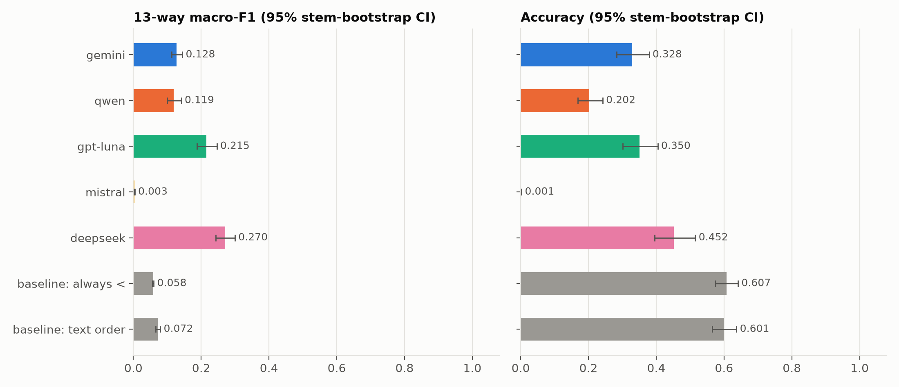

Per-relation F1:

| system | < | > | = | m | mi | o | oi | s | si | d | di | f | fi |
|---|---|---|---|---|---|---|---|---|---|---|---|---|---|
| gemini | 0.57 | 0.23 | 0.17 | 0.07 | 0.04 | 0.07 | 0.01 | 0.16 | 0.02 | 0.13 | 0.15 | 0.03 | 0.02 |
| qwen | 0.39 | 0.25 | 0.16 | 0.11 | 0.02 | 0.02 | 0.00 | 0.18 | 0.05 | 0.17 | 0.09 | 0.07 | 0.03 |
| gpt-luna | 0.57 | 0.41 | 0.20 | 0.20 | 0.11 | 0.04 | 0.04 | 0.16 | 0.12 | 0.34 | 0.33 | 0.14 | 0.14 |
| mistral | 0.00 | 0.00 | 0.00 | 0.01 | 0.00 | 0.00 | 0.00 | 0.00 | 0.00 | 0.00 | 0.00 | 0.00 | 0.00 |
| deepseek | 0.65 | 0.56 | 0.31 | 0.22 | 0.19 | 0.04 | 0.03 | 0.18 | 0.14 | 0.39 | 0.42 | 0.17 | 0.21 |

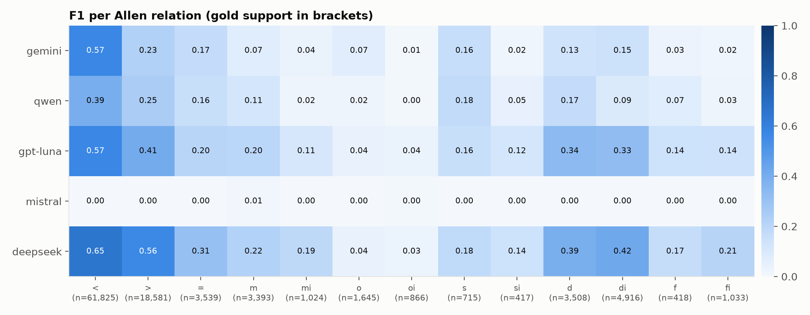

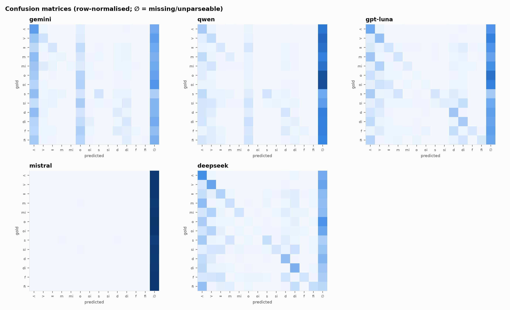

Pairwise model differences (macro-F1), paired stem bootstrap, Holm-adjusted:

| model_a | model_b | diff | diff_lo | diff_hi | p_boot | p_holm |
|---|---|---|---|---|---|---|
| gemini | qwen | 0.009 | -0.009 | 0.024 | 0.322 | 0.322 |
| gemini | gpt-luna | -0.088 | -0.114 | -0.064 | 0.002 | 0.020 |
| gemini | mistral | 0.125 | 0.111 | 0.141 | 0.002 | 0.020 |
| gemini | deepseek | -0.143 | -0.167 | -0.119 | 0.002 | 0.020 |
| qwen | gpt-luna | -0.096 | -0.117 | -0.076 | 0.002 | 0.020 |
| qwen | mistral | 0.116 | 0.097 | 0.138 | 0.002 | 0.020 |
| qwen | deepseek | -0.152 | -0.173 | -0.128 | 0.002 | 0.020 |
| gpt-luna | mistral | 0.213 | 0.185 | 0.243 | 0.002 | 0.020 |
| gpt-luna | deepseek | -0.055 | -0.073 | -0.038 | 0.002 | 0.020 |
| mistral | deepseek | -0.268 | -0.297 | -0.241 | 0.002 | 0.020 |

## A2 — Converse self-consistency

| model | pairs_both_valid | converse_violation_rate | upper_accuracy | lower_accuracy | lower_macro_f1 | both_directions_right |
|---|---|---|---|---|---|---|
| gemini | 48,452 | 0.213 | 0.328 | 0.318 | 0.128 | 0.256 |
| qwen | 26,116 | 0.376 | 0.202 | 0.192 | 0.106 | 0.128 |
| gpt-luna | 38,448 | 0.064 | 0.350 | 0.322 | 0.212 | 0.270 |
| mistral | 869 | 0.901 | 0.001 | 0.005 | 0.003 | 0.000 |
| deepseek | 53,916 | 0.003 | 0.452 | 0.482 | 0.272 | 0.399 |

Violation rate by gold relation:

| model | < | = | > | d | di | f | fi | m | mi | o | oi | s | si |
|---|---|---|---|---|---|---|---|---|---|---|---|---|---|
| gemini | 0.147 | 0.385 | 0.248 | 0.376 | 0.421 | 0.511 | 0.442 | 0.244 | 0.279 | 0.380 | 0.344 | 0.321 | 0.462 |
| qwen | 0.301 | 0.548 | 0.467 | 0.486 | 0.605 | 0.681 | 0.476 | 0.447 | 0.558 | 0.464 | 0.605 | 0.394 | 0.557 |
| gpt-luna | 0.043 | 0.067 | 0.120 | 0.082 | 0.098 | 0.063 | 0.044 | 0.063 | 0.127 | 0.099 | 0.102 | 0.041 | 0.074 |
| mistral | 0.891 | 0.852 | 0.972 | 0.919 | 0.945 | 1.000 | 0.889 | 0.775 | 1.000 | 0.000 | 0.500 | 0.727 | 1.000 |
| deepseek | 0.002 | 0.006 | 0.006 | 0.001 | 0.002 | 0.000 | 0.001 | 0.003 | 0.005 | 0.004 | 0.005 | 0.004 | 0.008 |

## A3 — Logical consistency

| system | stems | consistent_stems | complete_stems | bad_triples | checked_triples | pct_consistent | triple_violation_rate | pct_consistent_among_complete |
|---|---|---|---|---|---|---|---|---|
| gold | 360 | 328 | 360 | 640 | 1,145,756 | 0.911 | 0.001 | 0.911 |
| gemini | 360 | 133 | 207 | 12,915 | 419,040 | 0.369 | 0.031 | 0.329 |
| qwen | 360 | 125 | 114 | 11,762 | 174,061 | 0.347 | 0.068 | 0.167 |
| gpt-luna | 360 | 197 | 222 | 7,318 | 258,404 | 0.547 | 0.028 | 0.622 |
| mistral | 360 | 323 | 4 | 2,211 | 3,930 | 0.897 | 0.563 | 0.250 |
| deepseek | 360 | 308 | 242 | 543 | 439,101 | 0.856 | 0.001 | 0.876 |

### A3a — Offline repair to the nearest consistent network

| model | variant | raw_accuracy | raw_macro_f1 | repaired_accuracy | repaired_macro_f1 | delta_accuracy | delta_macro_f1 | stems_already_consistent | stems_optimal | stems_feasible_not_proven | stems_no_solution |
|---|---|---|---|---|---|---|---|---|---|---|---|
| gemini | i | 0.328 | 0.128 | 0.386 | 0.120 | 0.058 | -0.007 | 68 | 291 | 1 | 0 |
| gemini | ii | 0.328 | 0.128 | 0.417 | 0.132 | 0.089 | 0.004 | 27 | 328 | 5 | 0 |
| qwen | i | 0.202 | 0.119 | 0.279 | 0.119 | 0.077 | 0.000 | 19 | 340 | 1 | 0 |
| qwen | ii | 0.202 | 0.119 | 0.295 | 0.129 | 0.094 | 0.010 | 5 | 353 | 2 | 0 |
| gpt-luna | i | 0.350 | 0.215 | 0.432 | 0.206 | 0.082 | -0.009 | 138 | 222 | 0 | 0 |
| gpt-luna | ii | 0.350 | 0.215 | 0.476 | 0.220 | 0.126 | 0.005 | 92 | 266 | 2 | 0 |
| mistral | i | 0.001 | 0.003 | 0.054 | 0.019 | 0.053 | 0.017 | 1 | 357 | 2 | 0 |
| mistral | ii | 0.001 | 0.003 | 0.064 | 0.025 | 0.063 | 0.022 | 0 | 359 | 1 | 0 |
| deepseek | i | 0.452 | 0.270 | 0.538 | 0.257 | 0.086 | -0.013 | 212 | 148 | 0 | 0 |
| deepseek | ii | 0.452 | 0.270 | 0.591 | 0.277 | 0.139 | 0.007 | 205 | 155 | 0 | 0 |
| ensemble | i | 0.561 | 0.242 | 0.595 | 0.223 | 0.034 | -0.020 | 98 | 253 | 9 | 0 |

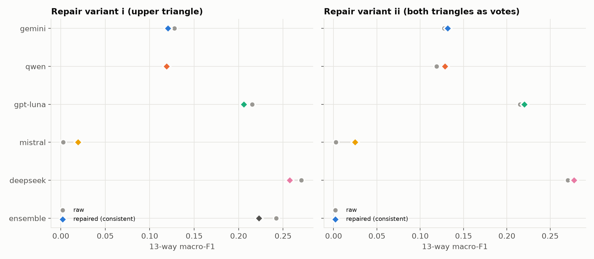

## A4 — Error anatomy at the endpoint level

| model | severity 1 | severity 2 | severity 3 | severity 4 |
|---|---|---|---|---|
| gemini | 0.334 | 0.242 | 0.141 | 0.283 |
| qwen | 0.325 | 0.248 | 0.127 | 0.300 |
| gpt-luna | 0.238 | 0.420 | 0.085 | 0.257 |
| mistral | 0.264 | 0.383 | 0.282 | 0.072 |
| deepseek | 0.264 | 0.435 | 0.107 | 0.194 |

Share of errors in which each endpoint comparison differs:

| model | diff_start_start | diff_start_end | diff_end_start | diff_end_end |
|---|---|---|---|---|
| gemini | 0.612 | 0.384 | 0.743 | 0.634 |
| qwen | 0.614 | 0.442 | 0.683 | 0.663 |
| gpt-luna | 0.577 | 0.398 | 0.702 | 0.684 |
| mistral | 0.626 | 0.183 | 0.773 | 0.578 |
| deepseek | 0.533 | 0.343 | 0.699 | 0.656 |

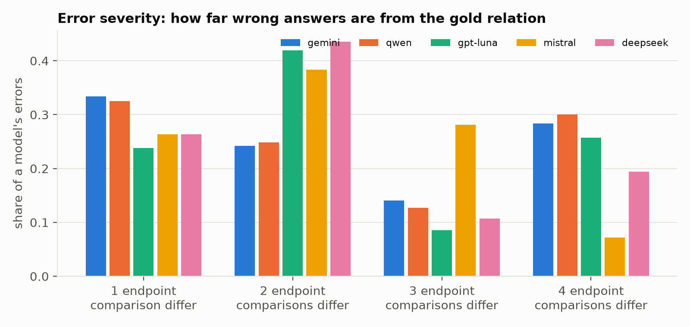

## A5 — Reading vs reasoning

| model | pairs | errors | share_errors_composition_available | self_entailment_violation_rate_all_valid | error_rate_local_pairs(sent_dist<=1) | error_rate_distant_pairs(sent_dist>=2) | share_comp_available_among_local_errors | share_comp_available_among_distant_errors |
|---|---|---|---|---|---|---|---|---|
| gemini | 101,880 | 68,423 | 0.013 | 0.110 | 0.761 | 0.614 | 0.012 | 0.013 |
| qwen | 101,880 | 81,315 | 0.019 | 0.213 | 0.861 | 0.758 | 0.014 | 0.022 |
| gpt-luna | 101,880 | 66,191 | 0.025 | 0.120 | 0.749 | 0.586 | 0.022 | 0.028 |
| mistral | 101,880 | 101,758 | 0.000 | 0.340 | 0.999 | 0.999 | 0.000 | 0.000 |
| deepseek | 101,880 | 55,844 | 0.041 | 0.009 | 0.608 | 0.510 | 0.038 | 0.044 |

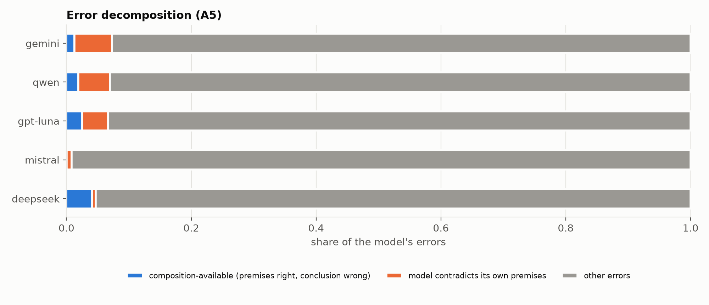

## A6 — Narrative order

| model | pairs_in_order | pairs_reversed | acc_in_order | acc_reversed | heuristic_reliance_rate | odds_ratio | or_lo | or_hi | p |
|---|---|---|---|---|---|---|---|---|---|
| gemini | 61,185 | 19,221 | 0.450 | 0.214 | 0.739 | 2.194 | 0.973 | 4.949 | 0.058 |
| qwen | 61,185 | 19,221 | 0.257 | 0.175 | 0.470 | 1.265 | 0.727 | 2.202 | 0.405 |
| gpt-luna | 61,185 | 19,221 | 0.436 | 0.282 | 0.765 | 0.834 | 0.521 | 1.337 | 0.451 |
| mistral | 61,185 | 19,221 | 0.001 | 0.001 | 0.003 | 8.690 | 4.690 | 16.103 | 0.000 |
| deepseek | 61,185 | 19,221 | 0.543 | 0.415 | 0.762 | 0.650 | 0.372 | 1.134 | 0.129 |

_GEE: correct ~ reversed + sentence-distance bin + gold relation, clustered by stem; odds ratio for reversed._

Macro-F1 by stem non-linearity (share of gold before/after pairs narrated in reverse):

| system | 0 | (0,10%] | (10,20%] | >20% |
|---|---|---|---|---|
| gemini | 0.226 | 0.130 | 0.106 | 0.095 |
| qwen | 0.187 | 0.105 | 0.125 | 0.088 |
| gpt-luna | 0.369 | 0.204 | 0.216 | 0.162 |
| mistral | 0.003 | 0.004 | 0.003 | 0.001 |
| deepseek | 0.393 | 0.272 | 0.284 | 0.204 |
| baseline: text order | 0.126 | 0.113 | 0.080 | 0.051 |

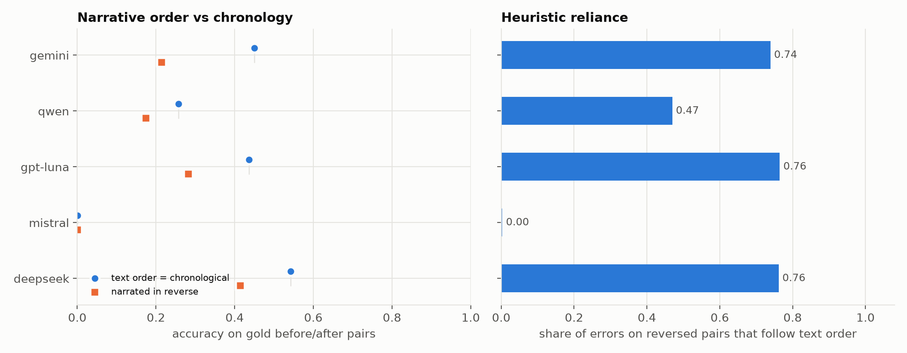

## A7 — Distance, position, length, drift, truncation

| model | same | 1 | 2-3 | 4-7 | 8+ |
|---|---|---|---|---|---|
| gemini | 0.108 | 0.144 | 0.128 | 0.129 | 0.112 |
| qwen | 0.087 | 0.143 | 0.135 | 0.117 | 0.107 |
| gpt-luna | 0.165 | 0.245 | 0.236 | 0.209 | 0.203 |
| mistral | 0.002 | 0.005 | 0.004 | 0.002 | 0.000 |
| deepseek | 0.229 | 0.296 | 0.268 | 0.276 | 0.276 |

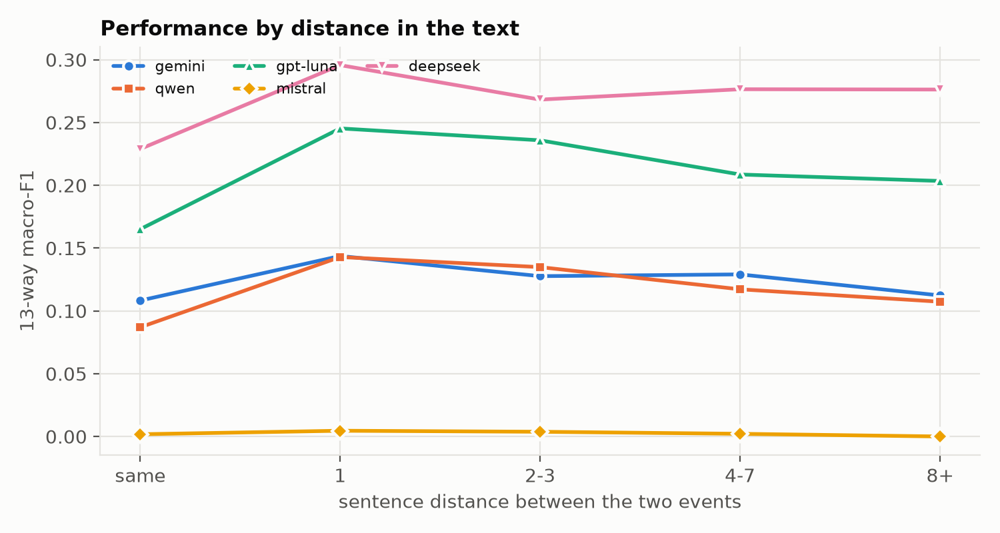

Event position (accuracy over pairs involving an event in that part of the passage):

| model | beginning | end | middle |
|---|---|---|---|
| gemini | 0.326 | 0.346 | 0.315 |
| qwen | 0.206 | 0.207 | 0.193 |
| gpt-luna | 0.358 | 0.355 | 0.339 |
| mistral | 0.002 | 0.001 | 0.001 |
| deepseek | 0.452 | 0.472 | 0.433 |

Stem-level regression (HC3 robust SE; predictors standardised):

| model | outcome | spearman_words | p_words | spearman_events | p_events | ols_coef_z_words | ols_p_words | ols_coef_z_events | ols_p_events | r2 |
|---|---|---|---|---|---|---|---|---|---|---|
| gemini | acc | -0.348 | 0.000 | -0.607 | 0.000 | 0.043 | 0.159 | -0.205 | 0.000 | 0.366 |
| gemini | macro_f1 | -0.413 | 0.000 | -0.658 | 0.000 | 0.025 | 0.052 | -0.132 | 0.000 | 0.302 |
| qwen | acc | -0.433 | 0.000 | -0.650 | 0.000 | 0.048 | 0.002 | -0.245 | 0.000 | 0.457 |
| qwen | macro_f1 | -0.479 | 0.000 | -0.680 | 0.000 | 0.020 | 0.081 | -0.135 | 0.000 | 0.338 |
| gpt-luna | acc | -0.428 | 0.000 | -0.579 | 0.000 | 0.003 | 0.856 | -0.243 | 0.000 | 0.681 |
| gpt-luna | macro_f1 | -0.523 | 0.000 | -0.585 | 0.000 | -0.011 | 0.378 | -0.144 | 0.000 | 0.449 |
| mistral | acc | -0.165 | 0.002 | -0.141 | 0.008 | 0.000 | 0.652 | -0.004 | 0.135 | 0.006 |
| mistral | macro_f1 | -0.165 | 0.002 | -0.136 | 0.010 | -0.001 | 0.185 | -0.002 | 0.034 | 0.018 |
| deepseek | acc | -0.442 | 0.000 | -0.545 | 0.000 | 0.011 | 0.547 | -0.196 | 0.000 | 0.498 |
| deepseek | macro_f1 | -0.494 | 0.000 | -0.572 | 0.000 | -0.021 | 0.065 | -0.124 | 0.000 | 0.364 |

| model | 16-25 | 26-40 | 41+ | 8-15 |
|---|---|---|---|---|
| gemini | 0.145 | 0.097 | 0.037 | 0.286 |
| qwen | 0.155 | 0.065 | 0.004 | 0.309 |
| gpt-luna | 0.302 | 0.149 | 0.033 | 0.463 |
| mistral | 0.002 | 0.000 | 0.000 | 0.011 |
| deepseek | 0.312 | 0.245 | 0.132 | 0.494 |

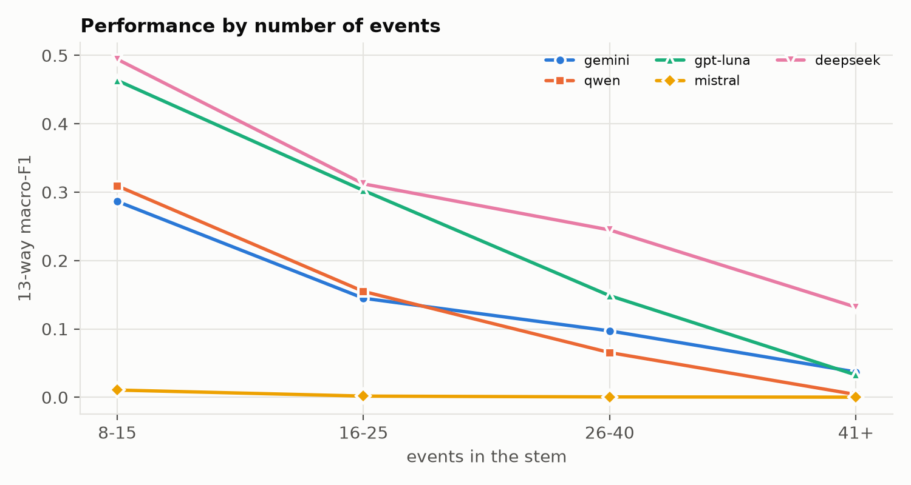

Truncation rate by event count:

| model | 16-25 | 26-40 | 41+ | 8-15 |
|---|---|---|---|---|
| gemini | 0.000 | 0.000 | 0.000 | 0.000 |
| qwen | 0.016 | 0.000 | 0.000 | 0.007 |
| gpt-luna | 0.000 | 0.000 | 0.030 | 0.000 |
| mistral | 0.110 | 0.333 | 0.364 | 0.000 |
| deepseek | 0.016 | 0.000 | 0.303 | 0.000 |

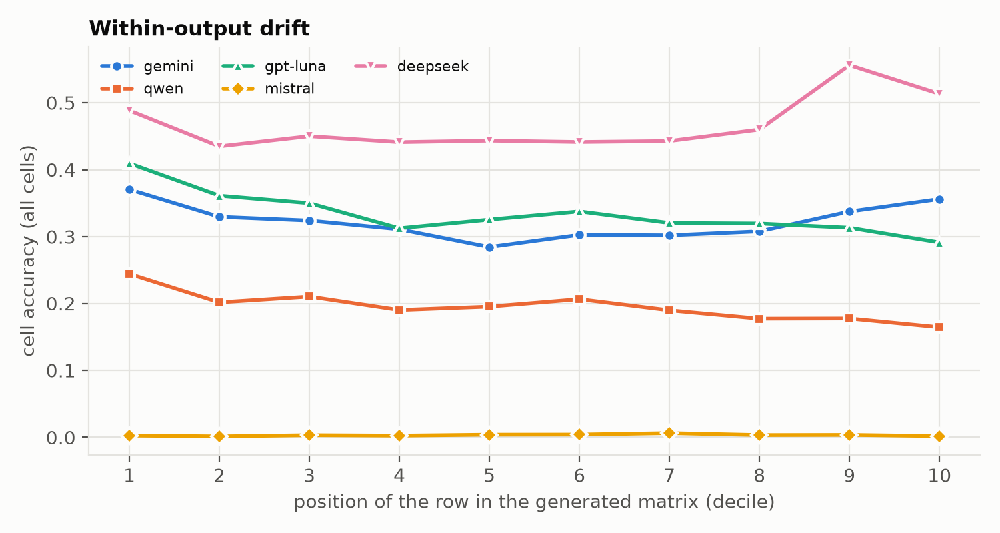

## A8 — Error concentration

_Stems with at least 5 errors for that model._

| model | stems_with_5plus_errors | mean_share_top1 | mean_share_top2 | pct_stems_top1_over_half | mean_error_rate | mean_error_rate_without_top1 |
|---|---|---|---|---|---|---|
| gemini | 354 | 0.249 | 0.419 | 0.051 | 0.481 | 0.437 |
| qwen | 355 | 0.237 | 0.399 | 0.062 | 0.563 | 0.521 |
| gpt-luna | 342 | 0.295 | 0.480 | 0.114 | 0.371 | 0.327 |
| mistral | 360 | 0.119 | 0.229 | 0.000 | 0.996 | 0.995 |
| deepseek | 335 | 0.312 | 0.497 | 0.122 | 0.338 | 0.293 |

## A9 — Interaction with known gold issues

| model | subset | stems | pairs | accuracy | macro_f1 |
|---|---|---|---|---|---|
| gemini | gold-consistent stems | 328 | 81,981 | 0.356 | 0.143 |
| gemini | gold-inconsistent stems | 32 | 19,899 | 0.213 | 0.057 |
| gemini | pairs in a bad gold triple | 32 | 778 | 0.000 | 0.000 |
| gemini | all other pairs | 360 | 101,102 | 0.331 | 0.129 |
| qwen | gold-consistent stems | 328 | 81,981 | 0.225 | 0.138 |
| qwen | gold-inconsistent stems | 32 | 19,899 | 0.107 | 0.040 |
| qwen | pairs in a bad gold triple | 32 | 778 | 0.003 | 0.003 |
| qwen | all other pairs | 360 | 101,102 | 0.203 | 0.121 |
| gpt-luna | gold-consistent stems | 328 | 81,981 | 0.389 | 0.244 |
| gpt-luna | gold-inconsistent stems | 32 | 19,899 | 0.192 | 0.101 |
| gpt-luna | pairs in a bad gold triple | 32 | 778 | 0.032 | 0.062 |
| gpt-luna | all other pairs | 360 | 101,102 | 0.353 | 0.218 |
| mistral | gold-consistent stems | 328 | 81,981 | 0.001 | 0.003 |
| mistral | gold-inconsistent stems | 32 | 19,899 | 0.000 | 0.000 |
| mistral | pairs in a bad gold triple | 32 | 778 | 0.001 | 0.002 |
| mistral | all other pairs | 360 | 101,102 | 0.001 | 0.003 |
| deepseek | gold-consistent stems | 328 | 81,981 | 0.497 | 0.290 |
| deepseek | gold-inconsistent stems | 32 | 19,899 | 0.267 | 0.200 |
| deepseek | pairs in a bad gold triple | 32 | 778 | 0.080 | 0.152 |
| deepseek | all other pairs | 360 | 101,102 | 0.455 | 0.272 |

Predictions on the (A, C) pair of gold *meets*-chains (gold: A m C; logically required: A < C):

| model | ac_pairs | pred_same_as_gold_meets | pred_logically_required_before_after | pred_other |
|---|---|---|---|---|
| gemini | 291 | 0.000 | 0.261 | 0.739 |
| qwen | 291 | 0.000 | 0.079 | 0.921 |
| gpt-luna | 291 | 0.027 | 0.165 | 0.808 |
| mistral | 291 | 0.000 | 0.000 | 1.000 |
| deepseek | 291 | 0.086 | 0.162 | 0.753 |

Candidate gold errors (≥ 4 models agree on the same label, different from gold): **665 pairs** (`A9_candidate_gold_errors.csv`). A random sample of 50 is in `results/analysis_inputs/A9_gold_error_audit_sample.csv` for manual checking; fill the column and re-run `python scripts/analyze.py --force --only A9 REPORT`.

| model | batch_item | stem_id | batch_pairs | batch_accuracy | primary_pairs | primary_accuracy |
|---|---|---|---|---|---|---|
| gemini | stem_50_batch_198 | 50 | 36 | 0.806 | 105 | 0.419 |
| gemini | stem_54_batch_263 | 54 | 153 | 0.588 | 276 | 0.351 |
| gemini | stem_62_batch_229 | 62 | 78 | 0.731 | 253 | 0.012 |
| gemini | stem_63_batch_230 | 63 | 91 | 0.659 | 496 | 0.169 |
| gemini | stem_64_batch_241 | 64 | 55 | 0.673 | 105 | 0.686 |
| gemini | stem_70_batch_232 | 70 | 153 | 0.477 | 276 | 0.228 |
| gemini | stem_102_batch_270 | 102 | 105 | 0.505 | 276 | 0.663 |
| gemini | stem_118_batch_271 | 118 | 91 | 0.451 | 171 | 0.485 |
| qwen | stem_50_batch_198 | 50 | 36 | 0.889 | 105 | 0.724 |
| qwen | stem_54_batch_263 | 54 | 153 | 0.608 | 276 | 0.178 |
| qwen | stem_62_batch_229 | 62 | 78 | 0.705 | 253 | 0.383 |
| qwen | stem_63_batch_230 | 63 | 91 | 0.593 | 496 | 0.141 |
| qwen | stem_64_batch_241 | 64 | 55 | 0.673 | 105 | 0.810 |
| qwen | stem_70_batch_232 | 70 | 153 | 0.712 | 276 | 0.431 |
| qwen | stem_102_batch_270 | 102 | 105 | 0.552 | 276 | 0.062 |
| qwen | stem_118_batch_271 | 118 | 91 | 0.626 | 171 | 0.538 |
| gpt-luna | stem_50_batch_198 | 50 | 36 | 0.861 | 105 | 0.752 |
| gpt-luna | stem_54_batch_263 | 54 | 153 | 0.673 | 276 | 0.717 |
| gpt-luna | stem_62_batch_229 | 62 | 78 | 0.872 | 253 | 0.375 |
| gpt-luna | stem_63_batch_230 | 63 | 91 | 0.758 | 496 | 0.573 |
| gpt-luna | stem_64_batch_241 | 64 | 55 | 0.673 | 105 | 0.914 |
| gpt-luna | stem_70_batch_232 | 70 | 153 | 0.824 | 276 | 0.471 |
| gpt-luna | stem_102_batch_270 | 102 | 105 | 0.619 | 276 | 0.768 |
| gpt-luna | stem_118_batch_271 | 118 | 91 | 0.692 | 171 | 0.795 |
| mistral | stem_50_batch_198 | 50 | 36 | 0.000 | 105 | 0.038 |
| mistral | stem_54_batch_263 | 54 | 153 | 0.000 | 276 | 0.000 |
| mistral | stem_62_batch_229 | 62 | 78 | 0.000 | 253 | 0.004 |
| mistral | stem_63_batch_230 | 63 | 91 | 0.000 | 496 | 0.000 |
| mistral | stem_64_batch_241 | 64 | 55 | 0.000 | 105 | 0.000 |
| mistral | stem_70_batch_232 | 70 | 153 | 0.000 | 276 | 0.000 |
| mistral | stem_102_batch_270 | 102 | 105 | 0.000 | 276 | 0.000 |
| mistral | stem_118_batch_271 | 118 | 91 | 0.000 | 171 | 0.000 |
| deepseek | stem_50_batch_198 | 50 | 36 | 0.861 | 105 | 0.838 |
| deepseek | stem_54_batch_263 | 54 | 153 | 0.882 | 276 | 0.000 |
| deepseek | stem_62_batch_229 | 62 | 78 | 0.795 | 253 | 0.593 |
| deepseek | stem_63_batch_230 | 63 | 91 | 0.582 | 496 | 0.585 |
| deepseek | stem_64_batch_241 | 64 | 55 | 0.673 | 105 | 0.952 |
| deepseek | stem_70_batch_232 | 70 | 153 | 0.843 | 276 | 0.551 |
| deepseek | stem_102_batch_270 | 102 | 105 | 0.667 | 276 | 0.891 |
| deepseek | stem_118_batch_271 | 118 | 91 | 0.000 | 171 | 0.830 |

## A10 — Cross-model analysis

| fleiss_kappa_all_models | pairs_all_valid | ensemble_accuracy | ensemble_macro_f1 | oracle_any_model_correct | pairs | pairs_no_model_correct | pairs_all_models_correct |
|---|---|---|---|---|---|---|---|
| 0.219 | 1,778 | 0.561 | 0.242 | 0.622 | 101,880 | 0.378 | 0.001 |

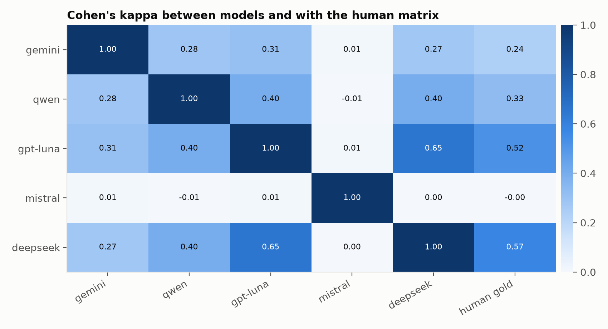

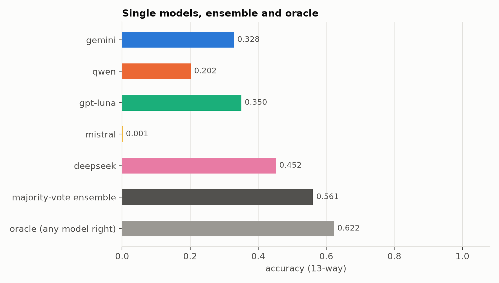

Mean number of models correct, by factor:

| factor | level | mean_models_correct | pairs |
|---|---|---|---|
| gold | < | 1.693 | 61,825 |
| gold | = | 0.557 | 3,539 |
| gold | > | 1.050 | 18,581 |
| gold | d | 0.811 | 3,508 |
| gold | di | 0.785 | 4,916 |
| gold | f | 0.299 | 418 |
| gold | fi | 0.281 | 1,033 |
| gold | m | 0.403 | 3,393 |
| gold | mi | 0.231 | 1,024 |
| gold | o | 0.314 | 1,645 |
| gold | oi | 0.054 | 866 |
| gold | s | 0.505 | 715 |
| gold | si | 0.221 | 417 |
| dist_bin | 1 | 1.337 | 14,646 |
| dist_bin | 2-3 | 1.608 | 18,852 |
| dist_bin | 4-7 | 1.603 | 21,576 |
| dist_bin | 8+ | 1.397 | 21,707 |
| dist_bin | same | 0.839 | 25,099 |
| reversed | 0.0 | 1.688 | 61,185 |
| reversed | 1.0 | 1.087 | 19,221 |
| reversed | – | 0.545 | 21,474 |
| derivable | False | 1.122 | 6,380 |
| derivable | True | 1.348 | 95,500 |

## A11 — Model attributes (descriptive only)

Fill `results/analysis_inputs/model_attributes.csv` (open weights, parameter count) and re-run `python scripts/analyze.py --force --only A11 REPORT`. With a handful of models these are descriptive associations only.

| model_id | model_key | reasoning_param_sent | open_weights (yes/no) | parameters_billion | notes | accuracy | macro_f1 | kappa |
|---|---|---|---|---|---|---|---|---|
| gemini | google/gemini-3.5-flash-lite | True | – | – | – | 0.328 | 0.128 | 0.105 |
| qwen | qwen/qwen3.7-flash | True | – | – | – | 0.202 | 0.119 | 0.083 |
| gpt-luna | openai/gpt-6-luna | True | – | – | – | 0.350 | 0.215 | 0.183 |
| mistral | mistralai/mistral-nemo | False | – | – | – | 0.001 | 0.003 | 0.000 |
| deepseek | deepseek/deepseek-v4.1-flash | True | – | – | – | 0.452 | 0.270 | 0.263 |

## A12 — Reliability and cost

| model | calls | parse_complete | parse_partial | parse_failed | truncated | cell_coverage_all_cells | completion_tokens | reasoning_tokens_reported | cost_usd | latency_median_s | retried_calls | macro_f1 | macro_f1_per_usd |
|---|---|---|---|---|---|---|---|---|---|---|---|---|---|
| gemini | 360 | 0.553 | 0.428 | 0.019 | 0.000 | 0.567 | 1,188,712 | 933,050 | 3.076 | 11.703 | 20 | 0.128 | 0.042 |
| qwen | 360 | 0.286 | 0.586 | 0.128 | 0.008 | 0.335 | 5,290,213 | 5,024,488 | 0.694 | 87.469 | 18 | 0.119 | 0.171 |
| gpt-luna | 360 | 0.569 | 0.408 | 0.022 | 0.003 | 0.462 | 1,933,773 | 1,647,802 | 1.007 | 43.992 | 5 | 0.215 | 0.214 |
| mistral | 360 | 0.006 | 0.350 | 0.644 | 0.117 | 0.022 | 1,028,362 | 0.000 | 0.040 | 10.164 | 30 | 0.003 | 0.065 |
| deepseek | 360 | 0.667 | 0.297 | 0.036 | 0.033 | 0.618 | 7,461,014 | 7,242,363 | 4.025 | 123.195 | 19 | 0.270 | 0.067 |

_reasoning_tokens_reported is as returned by the provider; some providers report 0 even when reasoning text was returned, so reasoning_chars in the CSV is the more reliable length measure._

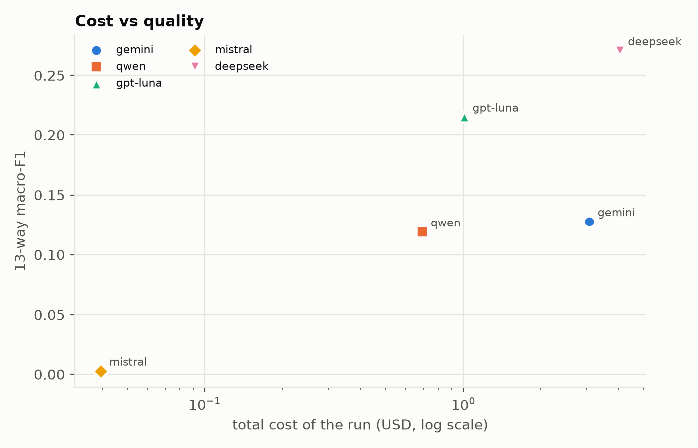

## A13 — Explicit durations

_Flag = either event's sentence contains a number + time-unit phrase (regex heuristic, not an annotation)._

| model | duration_phrase_in_either_sentence | pairs | accuracy | macro_f1 |
|---|---|---|---|---|
| gemini | True | 55,175 | 0.305 | 0.127 |
| gemini | False | 46,705 | 0.356 | 0.129 |
| qwen | True | 55,175 | 0.205 | 0.125 |
| qwen | False | 46,705 | 0.198 | 0.112 |
| gpt-luna | True | 55,175 | 0.344 | 0.212 |
| gpt-luna | False | 46,705 | 0.358 | 0.221 |
| mistral | True | 55,175 | 0.002 | 0.003 |
| mistral | False | 46,705 | 0.001 | 0.002 |
| deepseek | True | 55,175 | 0.458 | 0.273 |
| deepseek | False | 46,705 | 0.445 | 0.267 |

Manual tagging sample: `results/analysis_inputs/A13_arithmetic_tagging_sample.csv` (fill `requires_arithmetic`, then `python scripts/analyze.py --force --only A13 REPORT`).

## A14 — Passage type

Label each stem in `results/analysis_inputs/stem_types.csv` (column `type`), then run `python scripts/analyze.py --force --only A14 REPORT`.

## Robustness

| model | all stems | excluding duplicate-span stems (548, 550) | fully linear stems (no reversed pairs) | gold-consistent stems only | non-linear stems |
|---|---|---|---|---|---|
| gemini | 0.128 | 0.129 | 0.226 | 0.143 | 0.110 |
| qwen | 0.119 | 0.121 | 0.187 | 0.138 | 0.104 |
| gpt-luna | 0.215 | 0.218 | 0.369 | 0.244 | 0.188 |
| mistral | 0.003 | 0.003 | 0.003 | 0.003 | 0.002 |
| deepseek | 0.270 | 0.273 | 0.393 | 0.290 | 0.247 |

Reversed-pair odds ratio (A6) by subset:

| model | all stems | excluding duplicate-span stems (548, 550) | gold-consistent stems only |
|---|---|---|---|
| gemini | 2.194 | 2.098 | 2.216 |
| qwen | 1.265 | 1.185 | 1.334 |
| gpt-luna | 0.834 | 0.742 | 0.899 |
| mistral | 8.690 | 8.860 | 7.121 |
| deepseek | 0.650 | 0.613 | 0.687 |

## Mechanical hypothesis checks (pre-registered criteria, no interpretation)

| hypothesis | model | check | value |
|---|---|---|---|
| H1 | gemini | macro-F1 gain over best baseline vs accuracy gain over best baseline | ΔF1 = +0.055; ΔAcc = -0.278 |
| H1 | qwen | macro-F1 gain over best baseline vs accuracy gain over best baseline | ΔF1 = +0.047; ΔAcc = -0.405 |
| H1 | gpt-luna | macro-F1 gain over best baseline vs accuracy gain over best baseline | ΔF1 = +0.143; ΔAcc = -0.257 |
| H1 | mistral | macro-F1 gain over best baseline vs accuracy gain over best baseline | ΔF1 = -0.070; ΔAcc = -0.606 |
| H1 | deepseek | macro-F1 gain over best baseline vs accuracy gain over best baseline | ΔF1 = +0.198; ΔAcc = -0.155 |
| H1 | gemini | 4 lowest-F1 relations | oi (0.01), fi (0.02), si (0.02), f (0.03) |
| H1 | qwen | 4 lowest-F1 relations | oi (0.00), mi (0.02), o (0.02), fi (0.03) |
| H1 | gpt-luna | 4 lowest-F1 relations | oi (0.04), o (0.04), mi (0.11), si (0.12) |
| H1 | mistral | 4 lowest-F1 relations | si (0.00), > (0.00), f (0.00), di (0.00) |
| H1 | deepseek | 4 lowest-F1 relations | oi (0.03), o (0.04), si (0.14), f (0.17) |
| H6 | gemini | acc reversed < acc in order; heuristic reliance > 0.5 | 0.214 vs 0.450; reliance 0.74 |
| H6 | qwen | acc reversed < acc in order; heuristic reliance > 0.5 | 0.175 vs 0.257; reliance 0.47 |
| H6 | gpt-luna | acc reversed < acc in order; heuristic reliance > 0.5 | 0.282 vs 0.436; reliance 0.76 |
| H6 | mistral | acc reversed < acc in order; heuristic reliance > 0.5 | 0.001 vs 0.001; reliance 0.00 |
| H6 | deepseek | acc reversed < acc in order; heuristic reliance > 0.5 | 0.415 vs 0.543; reliance 0.76 |
| H4 | gemini | share of errors with severity 1 (> 0.5?) | 0.334 |
| H4 | qwen | share of errors with severity 1 (> 0.5?) | 0.325 |
| H4 | gpt-luna | share of errors with severity 1 (> 0.5?) | 0.238 |
| H4 | mistral | share of errors with severity 1 (> 0.5?) | 0.264 |
| H4 | deepseek | share of errors with severity 1 (> 0.5?) | 0.264 |
| H5 | gemini | share of distant-pair errors that are composition-available | 0.013 |
| H5 | qwen | share of distant-pair errors that are composition-available | 0.022 |
| H5 | gpt-luna | share of distant-pair errors that are composition-available | 0.028 |
| H5 | mistral | share of distant-pair errors that are composition-available | 0.000 |
| H5 | deepseek | share of distant-pair errors that are composition-available | 0.044 |
| H3 | gemini (i) | Δ macro-F1 after repair | -0.0072 |
| H3 | gemini (ii) | Δ macro-F1 after repair | +0.0040 |
| H3 | qwen (i) | Δ macro-F1 after repair | +0.0000 |
| H3 | qwen (ii) | Δ macro-F1 after repair | +0.0097 |
| H3 | gpt-luna (i) | Δ macro-F1 after repair | -0.0093 |
| H3 | gpt-luna (ii) | Δ macro-F1 after repair | +0.0050 |
| H3 | mistral (i) | Δ macro-F1 after repair | +0.0168 |
| H3 | mistral (ii) | Δ macro-F1 after repair | +0.0223 |
| H3 | deepseek (i) | Δ macro-F1 after repair | -0.0130 |
| H3 | deepseek (ii) | Δ macro-F1 after repair | +0.0071 |
| H3 | ensemble (i) | Δ macro-F1 after repair | -0.0196 |

## Limitations

- One sample per model: rankings closer than (unknown) run-to-run variance should not be over-interpreted.
- Some models do not accept temperature (see the run table); their provider default was used.
- The gold standard contains known issues (32 path-inconsistent stems; duplicate event wording in stems 548 and 550); see A9 and the robustness table.
- The repair solutions are best-found within a time limit, not always proven optimal.
- Passage-type (A14) and arithmetic (A13) analyses depend on manual labels in `results/analysis_inputs/`.
